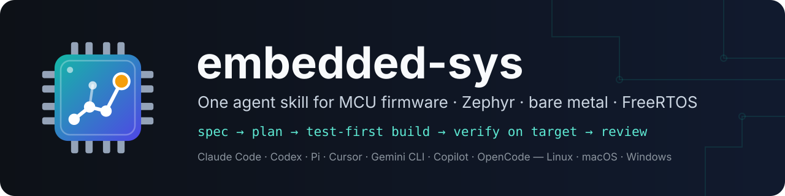
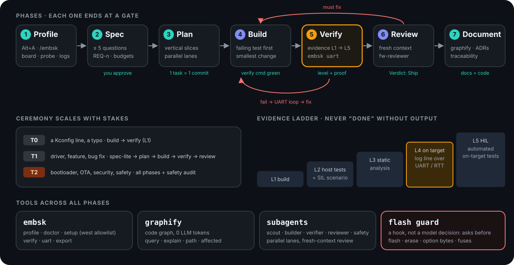
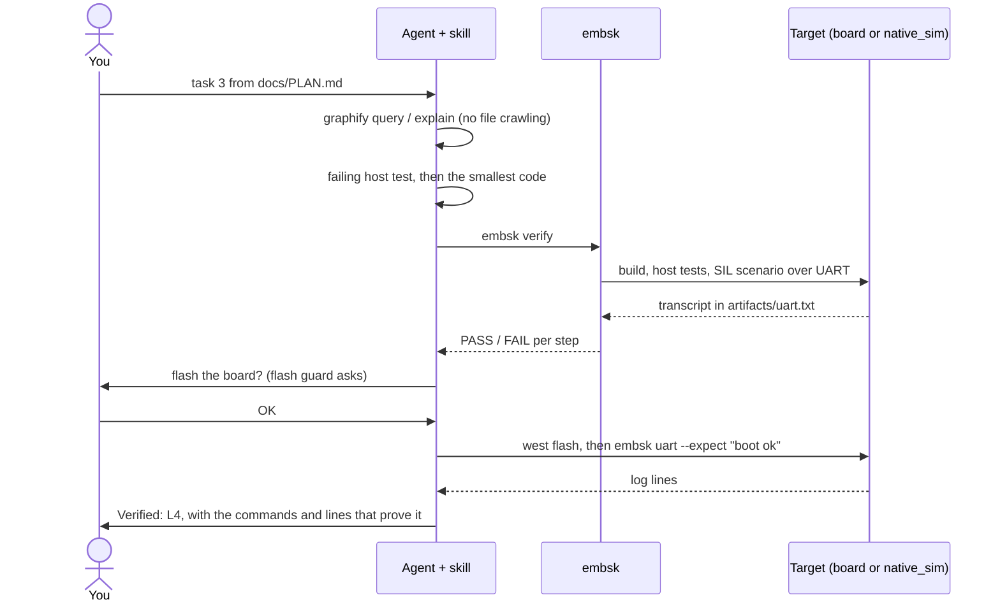
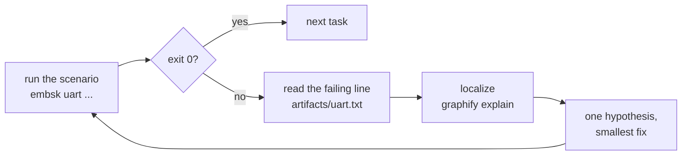

<p align="center">
  
</p>

<p align="center">
  <a href="https://github.com/YOUR-USER/embedded-sys/actions/workflows/check.yml"></a>
  
  
  
  <a href="LICENSE"></a>
</p>

<p align="center">
  <b>Turns your coding agent into a disciplined firmware engineer.</b><br>
  Spec → plan → test-first code → evidence from the running firmware → fresh-context review.<br>
  For MCU projects on <b>Zephyr</b>, <b>bare metal</b> and <b>FreeRTOS</b>, in Claude Code, Codex, Pi, Cursor, Gemini CLI, Copilot and OpenCode.
</p>

<p align="center">
  <a href="#see-it-work">See it work</a> ·
  <a href="#how-it-works">How it works</a> ·
  <a href="#quick-start">Quick start</a> ·
  <a href="INSTALL.md">Install</a> ·
  <a href="docs/README.md">Docs</a>
</p>

---

## Why

Firmware is where "it compiles" is furthest from "it works". Left alone, a coding agent guesses the board and the pins, writes C nobody runs, can't see the LED, and might flash or erase a target to "try something". `embedded-sys` gives the agent the workflow an embedded engineer follows:

| Without it | With `embedded-sys` |
|---|---|
| guesses board, pins, probe | a **profile** picked once with **Alt+A**, validated against the real Zephyr tree: the board exists, the MCU matches its SoC, the probe is a runner |
| re-derives build/flash commands every session | the exact commands are written into `AGENTS.md`; the agent uses those |
| "should work" | an **evidence ladder**: L1 build · L2 host tests + SIL · L3 static analysis · L4 log line from the target · L5 HIL. Every reply states its level |
| can't see the firmware | **`embsk uart`**: bounded send/expect sessions over the board's UART, or over the same app running on `native_sim` |
| reads the whole tree | **graphify** code graph (0 LLM tokens) plus the *resolved* devicetree and Kconfig |
| one long context, self-reviewed | parallel **subagents** on disjoint files, review by a **fresh-context** reviewer |
| might flash or erase on its own | a **flash guard** hook asks you before every flash, erase, option-byte or fuse operation |
| a full Zephyr workspace (68 projects, 9 GB) | `embsk setup` fetches **only the modules your board needs** (3 projects, ~40 s to a built image) |

## How it works

<p align="center"></p>

**Three layers, one contract:**

1. **Your machine.** `install.py` links the skill into your agents (Linux, macOS, Windows). The Zephyr SDK is yours, on PATH; the skill installs no toolchain.
2. **Your project.** Alt+A writes `.embsk/profile.json`. `embsk doctor` validates it, and `embsk` writes a block into `AGENTS.md` with the target, the commands and the hard rules. For Zephyr, `embsk setup` makes the folder a west workspace and builds.
3. **The agent.** It reads `SKILL.md` and that block, scales the ceremony to the stakes (T0 typo · T1 feature · T2 bootloader/safety), walks the phases, and loads only the references the profile needs.

One task, as it actually runs:



When a step fails, the agent loops on the evidence instead of guessing:



More diagrams (install → project → agent, spec → doc, artifacts per phase): [docs/11-flow.md](docs/11-flow.md).

## See it work

[`example/02-nucleo_f767zi-thermal-monitor`](example/02-nucleo_f767zi-thermal-monitor) is a real project built with the skill: the die temperature of a **NUCLEO-F767ZI** at 10 Hz, NORMAL/WARM/HOT on the three LEDs with hysteresis, a button-toggled report, shell commands and a watchdog. Its **[walkthrough](example/02-nucleo_f767zi-thermal-monitor/docs/WALKTHROUGH.md)** replays the whole session with real outputs. You can replay it **without the board**.

| Step | You | What happens |
|---|---|---|
| 1 | Alt+A → board `nucleo_f767zi`, probe `stlink`, logs `uart` | doctor validates; `embsk setup` fetches 3 projects and builds |
| 2 | *"new: thermal monitor … LEDs show NORMAL/WARM/HOT …"* | ≤ 5 questions, then [`docs/SPEC.md`](example/02-nucleo_f767zi-thermal-monitor/docs/SPEC.md): REQ-1..9, each with its verification |
| 3 | `plan it` | [ADR](example/02-nucleo_f767zi-thermal-monitor/docs/adr) + [`PLAN.md`](example/02-nucleo_f767zi-thermal-monitor/docs/PLAN.md): 9 tasks in 3 lanes; two lanes go to `fw-builder` subagents |
| 4 | `build the plan` | each task: failing test → smallest code → build |
| 5 | `verify` | build + 7 host tests + a **21-step SIL scenario over the UART** + size |
| 6 | `debug: …` | UART transcript → graphify → one hypothesis → fix (two real sessions in the walkthrough) |
| 7 | `review` | fresh-context reviewer: 2 test gaps found, proven by mutation, fixed |
| 8 | `flash it` | the flash guard asks you; then `embsk uart` on `/dev/ttyACM0` (L4) |

```console
$ embsk set board=nucleo_f767
  ERR  Board 'nucleo_f767' does not exist in this Zephyr tree. Close: nucleo_f767zi

$ embsk verify
build      PASS
test_host  PASS
sil        PASS
size       PASS

$ embsk uart --exec build-sim/zephyr/zephyr.exe --send "sim temp 70000" --sleep 1.5 --send "thermal status" --expect "state=HOT"
uart:~$ thermal status
t=70.000C avg=70.000C min=25.000C max=70.000C state=HOT
>> ok: /state=HOT/
>> 2/2 expects matched in 1.6 s; transcript: artifacts/uart.txt
```

The code graph the agent navigates (`graphify update .`, 98 nodes, 0 LLM tokens; the interactive version is [`graphify-out/graph.html`](example/02-nucleo_f767zi-thermal-monitor/graphify-out/graph.html)):

<p align="center"></p>

## Quick start

**You need:** Python 3.9+, git, and for Zephyr builds the [Zephyr SDK](https://docs.zephyrproject.org/latest/develop/toolchains/zephyr_sdk.html) with its toolchain on PATH, plus CMake, Ninja and dtc. On Windows, also [Git for Windows](https://git-scm.com/downloads/win), for the hooks.

```bash
git clone https://github.com/YOUR-USER/embedded-sys.git && cd embedded-sys
python3 install.py            # Windows: py -3 install.py
python3 install.py --check    # exit 0 = ready; prints what's missing (e.g. the Zephyr SDK on PATH)
```

The installer:
- puts the `embsk` command on PATH;
- links the skill into `~/.agents/skills` (read by Codex, Cursor, Gemini CLI, Copilot, OpenCode and Pi);
- adds the Claude Code plugin (`/embsk`, agents, flash guard, Alt+A), the Pi package (Alt+A, status, flash gate) and the Codex prompt, when those agents are present.

Details, other agents, uninstall: [INSTALL.md](INSTALL.md). **Agents asked to install it** follow the same file.

<details>
<summary>One-step alternatives (fewer features: no <code>embsk</code> on PATH)</summary>

```bash
# Claude Code only, from the marketplace in this repo
/plugin install embedded-sys --marketplace YOUR-USER/embedded-sys
# any Agent Skills tool (copies the skill folder)
npx skills add YOUR-USER/embedded-sys -g -a <agent> -y
```
Without the `embsk` command, agents fall back to `python3 <skill>/scripts/embsk.py`.
</details>

**Then, in an empty folder or a firmware repo:**

```bash
embsk menu        # or Alt+A in Pi / Claude Code / tmux: platform, board, probe, logs, safety, features
embsk setup       # Zephyr: west workspace with only this board's modules, then build
```

And talk to your agent:

| Say | The skill runs |
|---|---|
| `new: <product description>` | interview → `docs/SPEC.md` → plan → bring-up first |
| `task <n>` | failing test → smallest change → build → verify |
| `verify` | `embsk verify`: the evidence ladder as far as your setup goes |
| `debug: <symptom>` | reproduce over the UART → graphify → one hypothesis → fix |
| `review` | fresh-context `fw-reviewer` on the diff and the spec |
| `doc` | `graphify update .`, ADRs, README, traceability |

## Works with

| | Skill | Alt+A menu | Flash guard | Subagents |
|---|---|---|---|---|
| **Claude Code** | plugin | `/embsk` + Alt+A | hook | Task agents (`fw-*`) |
| **Pi** | `~/.agents/skills` | extension | extension gate | `spawn_agent` |
| **Codex** | `~/.agents/skills` | `/prompts:embsk`, tmux | plugin hook | worktrees + `codex exec` |
| **Cursor, Gemini CLI, Copilot, OpenCode** | `~/.agents/skills` | tmux / `embsk menu` | — | sequential |
| **Others** (Windsurf, Roo, Kiro, …) | `install.py --agent-dir <their skills dir>` | tmux / `embsk menu` | — | sequential |

Platforms: Zephyr 4.x (HWMv2 board names), bare metal (CMSIS/vendor SDK), FreeRTOS. Probes: OpenOCD, J-Link, pyOCD, ST-LINK/STM32CubeProgrammer, probe-rs, LinkServer, nrfutil, esptool, Black Magic.

## Repository layout

```
embedded-sys/
├── skills/embedded-sys/      the skill itself (portable, self-contained)
│   ├── SKILL.md              router: profile → tiers → phases + gates → rules → references
│   ├── references/           16 on-demand guides: zephyr, baremetal, rtos, peripherals, testing, debugging, review, …
│   ├── agents/               fw-scout · fw-builder · fw-verifier · fw-reviewer · fw-safety
│   ├── scripts/embsk.py      the CLI: menu, doctor, setup, verify, uart, export (stdlib Python)
│   └── templates/            Zephyr app, bare-metal app, SPEC, ADR, CONSTRAINTS
├── example/                  01 template · 02 thermal monitor (spec, plan, SIL, review, graph, walkthrough)
├── hooks/                    flash guard + session-start (pure bash)
├── .claude-plugin/ .codex-plugin/ commands/ pi-extension/ pi-workflows/ tmux/   agent adapters
├── install.py · install.sh   installer (Linux, macOS, Windows) · INSTALL.md
└── docs/                     architecture, CLI, workspace, integrations, flows, decisions, troubleshooting, quick-check.sh
```

## Documentation

| Read | For |
|---|---|
| [INSTALL.md](INSTALL.md) | install for any agent, with checks |
| [Example walkthrough](example/02-nucleo_f767zi-thermal-monitor/docs/WALKTHROUGH.md) | the full session, step by step |
| [docs/11-flow.md](docs/11-flow.md) | how it works, as graphs |
| [docs/03-agent-workflow.md](docs/03-agent-workflow.md) | tiers, phases, gates, rules, evidence ladder |
| [docs/04-embsk-cli.md](docs/04-embsk-cli.md) | every `embsk` command and the profile schema |
| [docs/05-zephyr-workspace.md](docs/05-zephyr-workspace.md) | `embsk setup`, the module allowlist, the Zephyr SDK from PATH |
| [docs/01-overview.md](docs/01-overview.md) | why one skill: what was merged, kept and dropped |
| [docs/README.md](docs/README.md) | the full docs index (handoff pack for agents) |

## Status

Version 1.0.0.
- **Verified on Linux:**
  - board index of 973 boards;
  - doctor catches wrong boards, MCU ↔ SoC mismatches and unsupported probes;
  - `embsk setup` from an empty folder in ~40 s;
  - example 02 (0 warnings, 7/7 host tests, SIL 21/21 over the UART);
  - flash guard: 27 cases;
  - installer end to end with the real Claude Code and Pi CLIs.
- **Self-test:** `bash docs/quick-check.sh` (90 checks offline; `--full` adds a real download, build and SIL run). CI runs it on Linux and runs the installer on Windows.
- **Not yet:**
  - no on-target (L4) run;
  - Windows covered by simulation plus the CI job;
  - Codex hooks and tmux untested.

Details: [docs/09-decisions-and-status.md](docs/09-decisions-and-status.md).

## Credits and license

MIT, see [LICENSE](LICENSE). `embedded-sys` merges and rewrites ideas from [LibreEmbed-Claude-Code](https://github.com/Ormus-Solutions/LibreEmbed-Claude-Code) (MIT), [ponytail](https://github.com/DietrichGebert/ponytail) (MIT) and [agent-skills](https://github.com/addyosmani/agent-skills) (MIT), and uses [graphify](https://github.com/Graphify-Labs/graphify) (Apache-2.0) as an external tool. Notices: [THIRD-PARTY-NOTICES.md](THIRD-PARTY-NOTICES.md). Contributions: [CONTRIBUTING.md](CONTRIBUTING.md).
