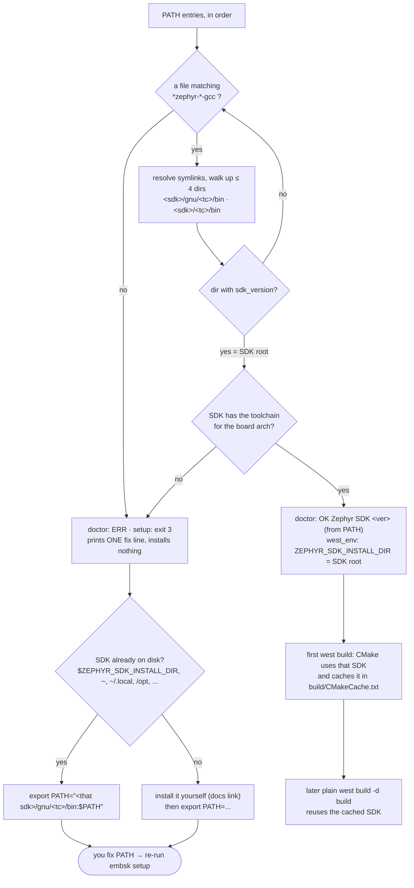

# 05 — Zephyr workspace automation (`embsk setup`)

Goal: the user chooses **only the board**. The skill creates a west workspace that fetches Zephyr plus **only the modules that board needs**, and builds.

## Layout (west "T2" topology: application = manifest repo)

```
my-project/               ← project root = west workspace topdir (west puts .west/ next to the manifest dir)
├── app/                  ← manifest repo + Zephyr application (commit)
│   ├── west.yml
│   ├── CMakeLists.txt    find_package(Zephyr REQUIRED HINTS $ENV{ZEPHYR_BASE})
│   ├── prj.conf
│   └── src/main.cpp      (template: blinky)
├── .embsk/  AGENTS.md  CLAUDE.md  docs/  .gitignore  .graphifyignore
├── .west/config          [manifest] path = app · [zephyr] base = deps/zephyr     (generated)
├── deps/zephyr/          (generated, shallow)
├── deps/modules/hal/…    (generated: only the allowlisted modules)
├── .venv/                (only if Zephyr Python deps were missing)
└── build/
```

`west init -l app` requires the manifest in a subfolder, so `app_dir="."` is rejected by setup.

## Manifest (written/patched by embsk)

```yaml
manifest:
  version: "1.0"
  projects:
    - name: zephyr
      url: https://github.com/zephyrproject-rtos/zephyr
      revision: v4.4.2            # ← profile zephyr_rev
      import:
        path-prefix: deps         # modules AND zephyr itself go under deps/
        name-allowlist:           # ← computed for the board
          - cmsis_6
          - hal_stm32
```

`write_manifest()` creates the file from `MANIFEST_TEMPLATE` if it is missing. Otherwise it patches only the zephyr `revision:` and the `name-allowlist:` list, preserving all other content. A manifest without an allowlist block is left untouched, with a warning.

## Module allowlist algorithm (`required_modules`)

1. Find the board in the tree → SoCs + arch.
2. SoC vendor: the first `zephyr/soc/<vendor>/**/soc.yml` that lists the SoC name.
3. HAL: `HAL[vendor]` (st → `hal_stm32`, raspberrypi → `hal_rpi_pico`, gd → `hal_gigadevice`, bflb → `hal_bouffalolab`, altr → `hal_altera`), else `hal_<vendor>` (nordic, nxp, espressif, adi, atmel, silabs, ti, microchip, renesas, infineon, ambiq, nuvoton, wch, telink, intel, realtek, …). The name is used only if it exists in Zephyr's `west.yml`, so vendors without a HAL (native, qemu, …) are skipped silently.
4. `ARCH_MODULES`: arch `arm` → `cmsis_6`.
5. `LOG_MODULES`: log `rtt` → `segger`.
6. `FEATURE_MODULES`: filesystem → littlefs · bootloader-ota → mcuboot, zcbor · secure-boot → mcuboot, mbedtls · dsp → cmsis-dsp · lora → loramac-node · display → lvgl.
7. `extra_modules` from the profile.
8. Drop names absent from Zephyr's manifest, with a note. Sort and de-duplicate.

Notes it prints:
- ST + `sensors` feature → ST MEMS drivers need `hal_st`.
- `/ns` targets → TF-M modules must be added via `extra_modules` (trusted-firmware-m, mbedtls-3.6, tf-psa-crypto).
- After update: any module whose `zephyr/module.yml` declares `blobs:` → `west blobs fetch <module>` may be required.

Verified mappings: nucleo_f767zi → `cmsis_6 hal_stm32` · nrf52840dk/nrf52840 → `cmsis_6 hal_nordic` · rpi_pico → `cmsis_6 hal_rpi_pico` · esp32s3_devkitc/esp32s3/procpu → `hal_espressif` · max32690evkit/max32690/m4 → `cmsis_6 hal_adi` · frdm_k64f → `cmsis_6 hal_nxp` · native_sim/native/64 → none · f767 + rtt + filesystem + bootloader-ota + extra hal_st → `cmsis_6 hal_st hal_stm32 littlefs mcuboot segger zcbor`.

## `setup()` step by step

1. **Project**: scaffold the template if `<app>/CMakeLists.txt` is missing. If an *enclosing* west workspace exists (topdir is a parent), use it and don't touch its manifest.
2. **Manifest**: compute modules from the best available tree (own workspace, or the `$ZEPHYR_BASE`/`~/zephyrproject` reference). A board not found in a reference tree → exit 1 before downloading. No tree at all → allowlist placeholder `- none`.
3. **West**: `ensure_python()` (see below). `ZEPHYR_BASE` is removed from the environment. Then `west init -l <app>` (first time only) → `west update --narrow -o=--depth=1` → `west config --local zephyr.base <path from 'west list -f {path} zephyr'>`. Modules are recomputed from the fetched tree; if the list changed, the manifest is rewritten and updated again. The blob notes are printed.
4. **Python deps**: west's interpreter (shebang of the `west` on PATH) must import `elftools, yaml, pykwalify, jsonschema, packaging`. Otherwise it creates `.venv`, `pip install west` + `-r deps/zephyr/scripts/requirements-base.txt`, and puts `.venv/bin` first on PATH for all later commands. CMake reuses west's interpreter through `WEST_PYTHON`.
5. **Toolchain**: `find_sdk(arch)` takes the Zephyr SDK from **PATH** only (see the next section). Missing → print one fix line and exit 3. embsk never installs it.
6. **Build**: `west build -b <board> -p auto -d build <app>` (skipped with `--no-build`).

Environment rule (`west_env`):
- Inside the project's own workspace, `ZEPHYR_BASE` = the workspace's Zephyr once it exists, and is unset before that.
- With no workspace (a plain app built against a reference tree), `ZEPHYR_BASE` = the reference tree.
- `ZEPHYR_SDK_INSTALL_DIR` = the SDK found on PATH (if any). It overrides a different value in your shell.
- `.venv/bin` is prepended to PATH if present.

## Zephyr SDK: your prerequisite, found on PATH

The skill ships **no toolchain**. `install.py`, `embsk setup` and the agent never download or install the Zephyr SDK. You install it once, outside the skill, and put one of its toolchains on `PATH`. embsk only *finds* it there and checks it.

```bash
# once per machine, by you (any install method; the official one: Zephyr docs → "Zephyr SDK")
#   e.g. tarball → ~/zephyr-sdk-1.0.1, then: ~/zephyr-sdk-1.0.1/setup.sh -t arm-zephyr-eabi
# then in ~/.bashrc / ~/.zshrc:
export PATH="$HOME/zephyr-sdk-1.0.1/gnu/arm-zephyr-eabi/bin:$PATH"   # SDK 1.x layout
# export PATH="$HOME/zephyr-sdk-0.17.4/arm-zephyr-eabi/bin:$PATH"   # SDK 0.x layout
```

How embsk resolves it (`sdk_from_path()`, `find_sdk()`, `sdk_hint()` in `embsk.py`):



| Rule | Why |
|---|---|
| PATH is the only source embsk trusts | one explicit, visible choice; the same SDK for every tool and terminal |
| embsk exports `ZEPHYR_SDK_INSTALL_DIR` for its own west/cmake calls | CMake never searches PATH for the SDK. Without this it could pick another SDK from its registry or `~`, `/opt`, ... (on the original host the registry pointed at 0.17.4 while 1.0.1 was in use) |
| The value is cached in `build/CMakeCache.txt` at the first configure | the agent's plain `west build -d build` from AGENTS.md keeps using the same SDK; a pristine/new build dir resolves again (run `embsk setup` after board changes) |
| `ZEPHYR_SDK_INSTALL_DIR` set to a *different* SDK → doctor `WARN` | a fresh plain `west build` would use it instead of the PATH one |
| Arch → toolchain | arm → `arm-zephyr-eabi`, riscv → `riscv64-zephyr-elf`, arm64 → `aarch64-zephyr-elf`, x86 → `x86_64-zephyr-elf`, arc → `arc-zephyr-elf`, xtensa → any `xtensa*`, other archs → `<arch>*`, posix (`native_sim`) → no SDK (host gcc) |
| One SDK on PATH covers every arch it contains | e.g. arm gcc on PATH, board switched to RISC-V: fine if the SDK has `riscv64-zephyr-elf` (`<sdk>/setup.sh -t riscv64-zephyr-elf` to add it) |

Check it any time: `embsk doctor` (`OK Zephyr SDK 1.0.1 at … (from PATH)`) or `python3 install.py --check`.

Windows: the SDK layout is the same (`<sdk>\gnu\arm-zephyr-eabi\bin\arm-zephyr-eabi-gcc.exe`). Add that `bin` folder to your user PATH; `embsk doctor` prints the exact PowerShell line.

## Re-runs and board changes

- Re-run with nothing changed: ~4 s (a tag revision is re-checked, then the build is a no-op).
- `embsk set board=<new>` (or Alt+A) → `embsk setup`: the allowlist is rewritten, only the new HAL is fetched, then `-p auto` rebuild. Modules no longer listed stay on disk (`rm -rf deps/modules/hal/<x>` to reclaim).
- New Zephyr version: `embsk set zephyr_rev=v4.x.y && embsk setup`.

## Manual equivalent (no embsk)

```bash
west init -l app
west update --narrow -o=--depth=1
west config --local zephyr.base deps/zephyr
export ZEPHYR_SDK_INSTALL_DIR=<your sdk>   # only if CMake would otherwise find a different SDK
west build -b nucleo_f767zi -p auto -d build app
```

## West facts this design depends on (verified with west 1.5.0)

| Fact | Consequence |
|---|---|
| `west init -l <dir>` creates `.west/` **next to** `<dir>` | the project folder is the topdir; the app lives in `app/` |
| An **empty** `name-allowlist` means "no filter" (`_is_imap_ok`: `no_allowlists`) | never write `[]`; use the non-matching placeholder `none` |
| `path-prefix` applies to the imported **zephyr** project too | don't set `path:` on zephyr (it would become `deps/deps/zephyr`) |
| `west init -l` does not set `zephyr.base` | setup sets it after the first update |
| A global `ZEPHYR_BASE` makes `west init` abort ("already initialized in …") and steers other commands to that workspace | unset for init/update, set to the own tree for builds |
| `--narrow -o=--depth=1` gives shallow clones of tags and SHAs on GitHub | ~160 MB download for the f767 case |

## Numbers (original host, nucleo_f767zi, Zephyr v4.4.2)

| | Full workspace (`~/zephyrproject`) | embsk allowlist |
|---|---|---|
| Projects | 68 | 3 (zephyr, cmsis_6, hal_stm32) |
| Disk | 9.2 GB (zephyr 1.4 GB, modules 7.0 GB) | 1.7 GB (zephyr 612 MB incl. 126 MB `.git`, hal_stm32 1.1 GB worktree / 28 MB `.git`, cmsis_6 28 MB) |
| Empty folder → built image | — | 36–45 s |

hal_stm32 is large because it checks out the Cube HAL for every STM32 series. A sparse checkout could cut it, but that isn't implemented (see backlog in [09](09-decisions-and-status.md)).
