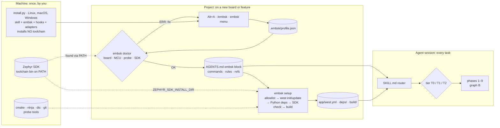
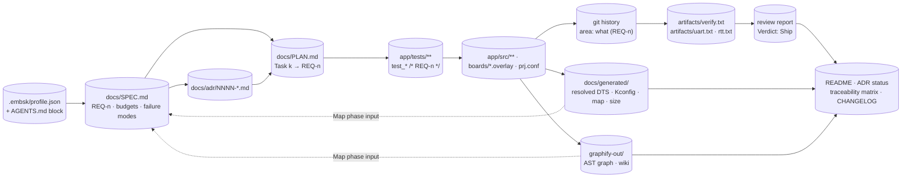
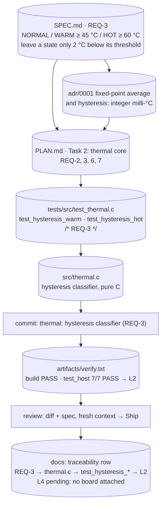

# 11 — How it works: end-to-end flow and the spec → doc graph

Four graphs, from coarse to fine:

- **A**: machine → project → agent: who provides what, and when each piece runs.
- **B**: the work graph from the spec to the docs: phases, gates and loops.
- **C**: the artifacts each node reads and writes.
- **D**: one real requirement traced through every node (example 02).

Sources of truth: [`SKILL.md`](../skills/embedded-sys/SKILL.md) (phases, gates, tiers), [`references/spec-plan.md`](../skills/embedded-sys/references/spec-plan.md), [`references/docs-release.md`](../skills/embedded-sys/references/docs-release.md). If you change one of them, update these graphs too.

Node shapes used in every graph:

| Shape | Meaning |
|---|---|
| `([ rounded ])` | start / end |
| `[ box ]` | phase or action |
| `{ diamond }` | gate: the next phase starts only when it holds |
| `[( cylinder )]` | file on disk (state lives in files, not in chat) |
| `{{ hexagon }}` | deterministic hook: a script decides, not the model |

## A. End to end: machine → project → agent



How it runs, step by step:

1. **You, once per machine**: install the Zephyr SDK and put its toolchain on PATH (`export PATH="<sdk>/gnu/arm-zephyr-eabi/bin:$PATH"`). Then run `python3 install.py` (Windows: `py -3 install.py`; guide: [INSTALL.md](../INSTALL.md)). It links the skill into `~/.agents/skills`, installs `embsk`, the Claude plugin, the Pi package and the Codex prompt. It installs no toolchain; it only reports whether the SDK is on PATH ([05](05-zephyr-workspace.md#zephyr-sdk-your-prerequisite-found-on-path)).
2. **Once per project**: Alt+A writes `.embsk/profile.json`. `embsk doctor` validates it against the real Zephyr tree (board, MCU ↔ SoC, probe ↔ runner) and checks for an SDK on PATH. `embsk render` writes the `embsk` block into `AGENTS.md`.
3. **Zephyr workspace**: `embsk setup` computes the module allowlist, runs `west init -l app` and a shallow `west update`, checks the Python deps, takes the SDK from PATH and builds. The first configure caches the SDK in `build/CMakeCache.txt`.
4. **Every session**: the agent reads the AGENTS.md block, loads SKILL.md, announces the tier and walks graph B. It uses only the commands from the block, and loads references on demand.

## B. The work graph: spec → doc

```mermaid
%%{init: {"flowchart": {"wrappingWidth": 400, "rankSpacing": 30, "nodeSpacing": 30}}}%%
flowchart TD
  IN(["task / description"]) --> TIER{"tier?"}
  TIER -- "T0" --> BUILD
  TIER -- "T1 · T2 · new project" --> MAP

  MAP["1 Map<br/>graphify query · explain · affected<br/>embsk export build"] --> G1{"touched files<br/>named?"}
  G1 -- no --> MAP
  G1 -- yes --> SPEC

  SPEC["2 Specify<br/>REQ-n · budgets · failure modes<br/>T1: spec-lite in chat"] --> G2{"user<br/>approved?"}
  G2 -- "no: ask, revise" --> SPEC
  G2 -- "T2 · new project" --> DESIGN
  G2 -- "T1" --> PLAN

  DESIGN["3 Design<br/>concurrency · DT/Kconfig plan<br/>core/shell split · ADRs · hazards"] --> G3{"every REQ<br/>mapped?"}
  G3 -- no --> DESIGN
  G3 -- yes --> PLAN

  PLAN["4 Plan<br/>vertical slices, bring-up first<br/>task = files + test + verify cmd"] --> G4{"tasks small,<br/>verifiable?"}
  G4 -- no --> PLAN
  G4 -- yes --> BUILD

  BUILD["5 Build, per task<br/>failing test → smallest code<br/>→ target build → size"] --> G5{"verify cmd<br/>green?"}
  G5 -- no --> BUILD
  G5 -- yes --> COMMIT["commit<br/>area: what (REQ-n)"]
  COMMIT --> MORE{"more<br/>tasks?"}
  MORE -- yes --> BUILD
  MORE -- no --> VERIFY

  VERIFY["6 Verify<br/>L1 build · L2 host · L3 static"] --> HW{"board +<br/>on-target?"}
  HW -- no --> LVL
  HW -- yes --> FG{{"flash-guard<br/>user OK?"}}
  FG -- refused --> LVL
  FG -- OK --> ONT["flash → L4 log in artifacts/*.txt<br/>L5 HIL"]
  ONT --> LVL
  LVL{"level +<br/>evidence?"} -- "no: failure" --> BUILD
  LVL -- "T0" --> DONE
  LVL -- "T1 · T2" --> REVIEW

  REVIEW["7 Review, fresh context<br/>diff + connected code + spec<br/>T2: + fw-safety, doubt loop"] --> G7{"verdict?"}
  G7 -- "Must fix" --> BUILD
  G7 -- "Ship, T1" --> DONE
  G7 -- "Ship, T2 · new project" --> DOCS

  DOCS["8 Document<br/>graphify update · README · ADRs<br/>T2: traceability REQ → code → test"] --> G8{"docs =<br/>code?"}
  G8 -- no --> DOCS
  G8 -- yes --> REL{"T2 or<br/>asked?"}
  REL -- no --> DONE
  REL -- yes --> RELEASE["9 Release<br/>version · changelog · signed image<br/>hashes · rollback"] --> DONE

  DONE(["reply: Verified L-n + commands<br/>Skipped / not checked"])
```



Reading the graph:

- **Tiers cut edges, never gates.** T0 jumps straight to Build and stops after L1. T1 skips Design and Document. T2 and new projects walk every node. A new project runs 3 → 8 once per slice.
- **Every failure loops back to Build**: a red verify command, a missing evidence level, a "Must fix" in review. Spec and design gates loop on themselves until the user or the mapping says yes.
- **The only node that touches hardware** is behind the `flash-guard` hexagon. No OK, or no board: the ladder stops at L2/L3 and the reply says so.
- **Bugs** enter at `debugging.md` (reproduce → minimize → one hypothesis → instrument → fix the root cause → regression test), then rejoin at node 6.

## C. What flows along the edges



| Node | Reads | Writes | Gate | Role (subagent) | Reference |
|---|---|---|---|---|---|
| 1 Map | graphify graph, `docs/generated/`, AGENTS.md | nothing (facts in chat) | files and symbols named | `fw-scout` | `context-graphify.md` |
| 2 Specify | description, profile, board RAM/flash from doctor | `docs/SPEC.md` (T1: chat) | user approved | — (talks to the user) | `spec-plan.md` |
| 3 Design | SPEC, Zephyr bindings/drivers, datasheets | `docs/adr/*.md`, concurrency and DT/Kconfig plan, hazard table | every REQ has a component | `fw-scout` | platform + feature refs |
| 4 Plan | SPEC, ADRs | `docs/PLAN.md` (T1: todo list) | tasks ≤ 1 commit and verifiable alone | — | `spec-plan.md` |
| 5 Build | one task card | tests, sources, overlay, `prj.conf`, a commit | task verify command green | `fw-builder` (disjoint files) | `coding.md` |
| 6 Verify | AGENTS.md commands | `artifacts/verify.txt`, `artifacts/uart.txt` / `rtt.txt` | level stated with evidence | `fw-verifier` | `testing-verification.md` |
| 7 Review | diff, connected code, SPEC | review report | Verdict: Ship | `fw-reviewer` (+ `fw-safety`, T2) | `review.md`, `safety.md` |
| 8 Document | code, ADRs, evidence, `docs/generated/` | README, ADR status, traceability, `graphify-out/` | docs match code | — | `docs-release.md` |
| 9 Release | all of the above | VERSION, CHANGELOG, signed image, hashes | release checklist green | `fw-verifier` | `docs-release.md`, `boot-ota-security.md` |

## D. One requirement through the nodes (example 02, REQ-3)

Every file in this thread exists in [`example/02-nucleo_f767zi-thermal-monitor`](../example/02-nucleo_f767zi-thermal-monitor/). The commit and review nodes are illustrative (the example ships without git history or a stored review report).



Check the thread with plain greps (this is how the T2 traceability matrix is built, see `safety.md` §Traceability):

```bash
cd example/02-nucleo_f767zi-thermal-monitor
rg -n "REQ-3" docs/ app/          # spec row, plan task, tests that claim it
rg -n "ZTEST\(thermal" app/tests  # tests that exist
cat artifacts/verify.txt          # after `embsk verify`: the evidence and its level
```
