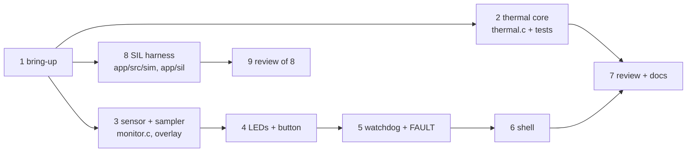

# Plan: thermal monitor (tier T1)

Vertical slices, each one commit, each verified before the next. Commands come from the `embsk` block in AGENTS.md.

| # | Task | Files | Test first | Verify | Status |
|---|---|---|---|---|---|
| 1 | **Bring-up**: workspace (allowlist = `cmsis_6`, `hal_stm32`), app skeleton, boot line | `app/west.yml`, `app/CMakeLists.txt`, `app/prj.conf`, `app/VERSION`, `app/src/main.c` | — | `embsk setup` builds; L4: `boot ok v0.1.0` in `artifacts/uart.txt` | done |
| 2 | **Thermal core**: moving average, hysteresis, plausibility, formatting (REQ-2, 3, 6, 7) | `app/src/thermal.[ch]`, `app/tests/**` | `app/tests/src/test_thermal.c` (7 cases) | `test_host` row: ztest on `native_sim/native/64` | done |
| 3 | **Sensor + sampler thread** at 10 Hz with drift-free timing; enable `die_temp` in DT (REQ-1) | `app/boards/nucleo_f767zi.overlay`, `app/src/monitor.c` | core already tested | target build; L4: `thermal: t=` lines after B1 | done |
| 4 | **LEDs + button** (ISR → work queue, 50 ms debounce) (REQ-4, 5) | `app/src/monitor.c` | — (hardware shell) | review of ISR/thread contexts; L4 visual | done |
| 5 | **Watchdog + reset cause + FAULT handling** (REQ-7, 8, 9) | `app/src/monitor.c`, `app/src/main.c` | fault path logic in core tests | review; L4: `reset=` in boot line | done |
| 6 | **Shell** `thermal status|thresholds` (REQ-6) | `app/src/shell_cmds.c` | validation covered by core tests | L4: shell output in `artifacts/uart.txt` | done |
| 7 | Review (`review.md`), docs, size check | — | — | `embsk verify` all PASS | done |
| 8 | **SIL harness**: same app on `native_sim/native/64`, simulated die sensor + watchdog behind the Zephyr APIs, LEDs/B1 on `gpio_emul`, `sim` shell, scenario per REQ (REQ-3..7, 9) | `app/boards/native_sim_native_64.{overlay,conf}`, `app/dts/bindings/vnd,sim-*.yaml`, `app/src/sim/*`, `app/sil/thermal.sil`, 1 line in `app/CMakeLists.txt` | the scenario, one block of steps per REQ | `sil` row: 21/21 expects; board image unchanged (91 376 B) | done |
| 9 | Review of task 8 → 2 findings fixed (debounce and LEDs-in-HOT unchecked) | `app/src/sim/sim_shell.c`, `app/sil/thermal.sil` | mutation: each finding's broken code must fail the scenario | `docs/review/0001-sil-harness.md` | done |

## Lanes (what runs in parallel)



| Lane | Tasks | Why it can run alone | Owner |
|---|---|---|---|
| A | 2 | only `thermal.[ch]` + `tests/` | `fw-builder` #1 |
| B | 3 → 4 → 5 → 6 | all touch `monitor.c` → one writer, in order | main session (it also owns the board and the serial port) |
| C | 8 | only new files + one CMake line | `fw-builder` #2 |
| — | 7, 9 | need the finished diff | `fw-reviewer` (fresh context) |

Spawn plan (Pi; the walkthrough §4 has Claude Code and Codex):
```text
spawn_agent task_name="build_t2" fork_turns="2" message="<agents/fw-builder.md>\n\nTASK t2 ... FILES (only these): app/src/thermal.c app/src/thermal.h app/tests/**"
spawn_agent task_name="build_t8" fork_turns="2" message="<agents/fw-builder.md>\n\nTASK t8 ... FILES (only these): app/src/sim/** app/sil/** app/boards/native_sim_native_64.* app/dts/bindings/**"
wait_agent  {all: true}        # then the main session runs `embsk verify`
spawn_agent task_name="review_1" fork_turns="none" message="<agents/fw-reviewer.md>\n\nDIFF: tasks 2+8\nCONTRACT: docs/SPEC.md"
```

Risks: the die sensor reads the junction temperature (5–15 °C above ambient), so the defaults (45/60 °C) assume a board on a desk. Thresholds are adjustable from the shell.
