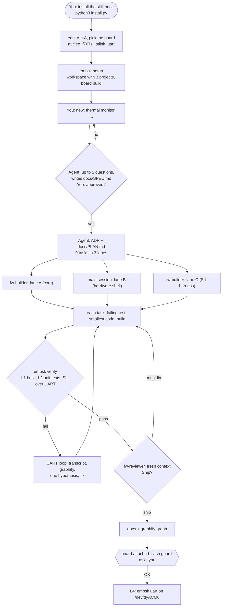
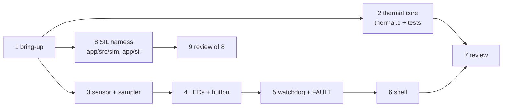
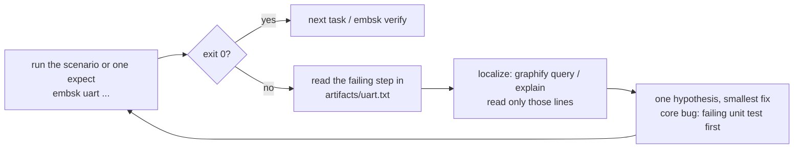
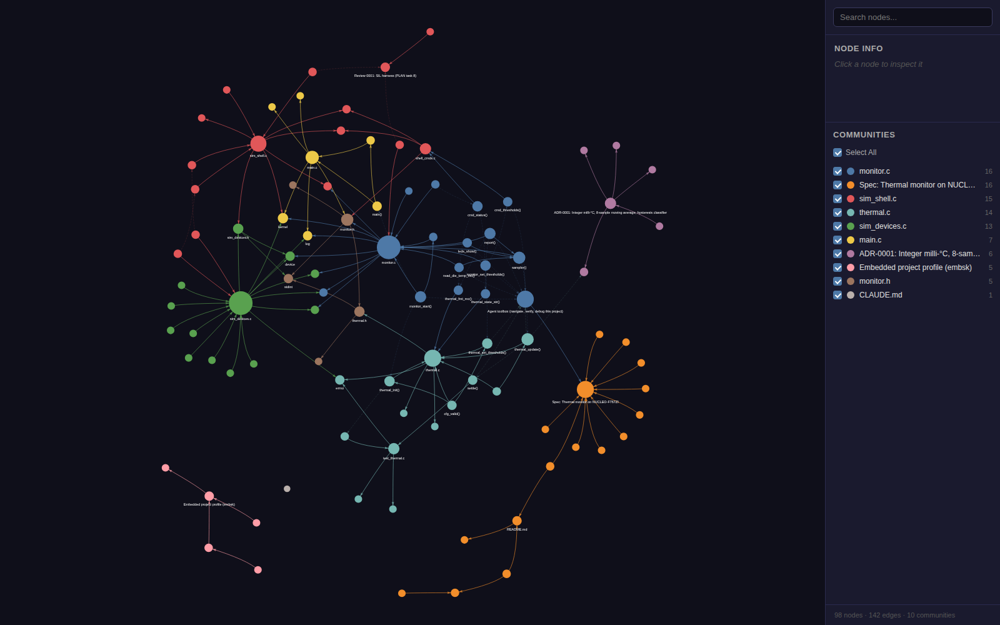

# Walkthrough: building the thermal monitor with the `embedded-sys` skill

This is the session that produced this project, written as a script you can replay with any agent (Claude Code, Pi, Codex, Cursor, …):
- **You:** lines are what you type or say.
- **Agent:** lines are what the skill makes the agent do.

All command outputs are real, captured on Linux with Zephyr 4.4.2 and Zephyr SDK 1.0.1; trimmed parts are marked `…`. The board steps (§8, L4) were **not** run: no board was attached. Everything else runs without hardware.

## The session at a glance



| § | You | Agent and skill | Result |
|---|---|---|---|
| 0 | install once | `install.py`, `--check` | skill, `embsk`, hooks |
| 1 | Alt+A: board, probe, logs | `embsk doctor`, `embsk setup` | profile, AGENTS.md, first build |
| 2 | describe the product | interview, `templates/SPEC.md` | `docs/SPEC.md` |
| 3 | `plan it` | ADR, vertical slices, lanes | `docs/adr/`, `docs/PLAN.md` |
| 4 | `build the plan` | subagents per lane, TDD per task | code + tests |
| 5 | `verify` | `embsk verify` | L1 + L2 + SIL evidence |
| 6–7 | `debug: <symptom>` | `embsk uart` loop, graphify | fix + regression check |
| 8 | `flash it` (board) | flash guard, `embsk uart --port` | L4 evidence |
| 9 | `review` | `fw-reviewer`, fresh context | `docs/review/0001-…` |
| 10 | `doc` | `graphify update .`, `embsk export` | `graphify-out/graph.html` |

## 0. Once per machine

```bash
python3 install.py && python3 install.py --check   # Windows: py -3 install.py (INSTALL.md)
export PATH="$HOME/zephyr-sdk-1.0.1/gnu/arm-zephyr-eabi/bin:$PATH"   # your Zephyr SDK, in your shell rc
uv tool install graphifyy                          # optional, for §10
```

The skill installs no toolchain. The Zephyr SDK is yours, found through PATH.

## 1. Configure the board (you, 2 minutes)

### 1.1 Alt+A

Press **Alt+A** in Pi, Claude Code (`/embsk`) or tmux, or run `embsk menu` in a terminal. The rows for this project (rendered with the menu's own format):

```
 embsk - embedded profile  [~/work/thermal]
   Platform                     < zephyr >
 > Zephyr board                 nucleo_f767zi
   MCU / SoC                    stm32f767xx
   App directory                app
   Zephyr revision              v4.4.2
   Extra west modules           (none)
   Host test board              native_sim/native/64
   CPU core                     < auto >
   Toolchain                    < zephyr-sdk >
   Debug probe                  < stlink >
   Log transport                < uart >
   Serial port                  /dev/ttyACM0
   Test framework               < ztest >
   Hardware in loop             < board >
   Safety standard              < none >
   Coding standard              < none >
 -- Features --
   [ ] low-power … [x] sensors … [ ] secure-boot
   Code discipline (ponytail)   < full >
   graphify code map            [x]
   Use subagents                [x]
   Auto-commit per task         [ ]
 Up/Down move · Left/Right/Space change · Enter edit/search · s save · q quit
```

What you do, row by row:
1. **Zephyr board**: Enter opens a search. Type `f767` (or `stm32f767`, or `nucleo`), then pick `nucleo_f767zi`. The MCU fills in from the board's SoC.
2. **Debug probe**: `stlink`, because the Nucleo carries an ST-LINK/V2-1. **Log transport**: `uart`; the ST-LINK virtual COM port is USART3. **Serial port**: `/dev/ttyACM0` (Windows: `COM5` or similar).
3. **Hardware in loop**: `board` if you will connect it; this adds "expected line from the target" to the agent's definition of done. **Features**: `sensors`.
4. Press `s`. The doctor runs; any error is shown before saving. Then it asks *"Set up the west workspace … and build now? [Y/n]"*: answer `Y` (that is §1.4).

### 1.2 The same in one command

This is also what `/embsk` in Claude Code ends with, after its checkbox questions:

```console
$ embsk boards stm32f767
nucleo_f767zi                                soc=stm32f767xx      arch=arm     runners=jlink,openocd,stm32cubeprogrammer
$ embsk set platform=zephyr board=nucleo_f767zi debugger=stlink log=uart serial_port=/dev/ttyACM0 tests=ztest hil=board features=sensors
updated /tmp/thermal/AGENTS.md
  OK   Zephyr 4.4.0-rc3 at /home/arouatbi/zephyrproject/zephyr
  OK   Board nucleo_f767zi (Nucleo F767ZI) SoC stm32f767xx arch arm RAM 384K flash 2048K
  OK   Probe 'stlink' supported by board (runners: jlink, openocd, stm32cubeprogrammer)
  OK   Zephyr SDK 1.0.1 at /home/arouatbi/zephyr-sdk-1.0.1/zephyr-sdk-1.0.1 (from PATH)
```

### 1.3 Wrong names are caught before any build

```console
$ embsk set board=nucleo_f767
  ERR  Board 'nucleo_f767' does not exist in this Zephyr tree. Close: nucleo_f767zi
$ embsk set board=nucleo_f767zi mcu=STM32F407VG
  ERR  MCU 'STM32F407VG' does not match board SoC stm32f767xx — fix MCU or pick another board
```

### 1.4 `embsk setup`

In an empty folder, setup first copies the template app (a blinky). Here it builds the finished app:

```console
$ embsk setup
== 1/6 project  /tmp/ex02  (app: app/, board: nucleo_f767zi)
== 2/6 manifest  name-allowlist = only the modules this board needs
== 3/6 west init + update (shallow: --narrow, depth 1)
  $ west init -l app
  $ west update --narrow -o=--depth=1
=== updating zephyr (deps/zephyr):
=== updating cmsis_6 (deps/modules/hal/cmsis_6):
=== updating hal_stm32 (deps/modules/hal/stm32):
== 4/6 python deps
  ok  west: /home/arouatbi/.local/bin/west  python: /usr/bin/python3
== 5/6 toolchain (Zephyr SDK: user-installed, taken from PATH)
  ok  Zephyr SDK 1.0.1 at /home/arouatbi/zephyr-sdk-1.0.1/zephyr-sdk-1.0.1 (from PATH)
== 6/6 build
           FLASH:       91376 B         2 MB      4.36%
             RAM:         16 KB       384 KB      4.17%
setup done: nucleo_f767zi builds. …
real	0m38.123s
```

### 1.5 What the agent reads from now on

`embsk` wrote a block into `AGENTS.md` (Claude Code reads it through `CLAUDE.md`). Its command table is the contract: the agent uses these commands and never re-derives them.

| Step | Command |
|---|---|
| build | `west build -b nucleo_f767zi -p auto -d build app` |
| test_host | `west build -b native_sim/native/64 -p auto -d build-test app/tests && ./build-test/zephyr/zephyr.exe` |
| sil | `west build -b native_sim/native/64 -p auto -d build-sim app && embsk uart --exec build-sim/zephyr/zephyr.exe --script app/sil/thermal.sil` |
| flash | `west flash -d build --runner stm32cubeprogrammer` |
| debug | `west debug -d build --runner openocd` |
| uart | `embsk uart --send "<shell command>" --expect "<reply regex>"` |

Below the table are the hard rules: flash only with your OK; done means build + host tests + SIL + target line; query before reading; ponytail; cite the datasheet. It also lists the references to load for this profile: `coding`, `review`, `testing-verification`, `debugging`, `zephyr`, `rtos` and `peripherals`.

## 2. Describe the product → the spec

**You:**
```text
new: thermal monitor on the NUCLEO-F767ZI. Read the MCU die temperature, show
NORMAL / WARM / HOT on the three user LEDs, report over the ST-LINK USB serial,
B1 toggles a periodic report. No extra hardware.
```

**Agent:** announces the tier: *"T1: new feature, no safety standard, nothing that can brick the board (no bootloader or flash-layout change)."* You can override it. Then it loads `references/spec-plan.md` and interviews you: at most 5 questions, one at a time, each with its guess. A condensed example of that dialogue:

> **Agent:** I think you want a bench indicator, not a safety limit (70 % sure). Q1: sample rate? My guess: 10 Hz, averaged over 8 samples.
> **You:** yes.
> **Agent:** Q2: thresholds? My guess: WARM at 45 °C and HOT at 60 °C, with a 2 °C hysteresis. The die runs 5–15 °C above ambient.
> **You:** ok, and make them changeable from a shell.
> **Agent:** Q3: a bad sensor reading? My guess: reject anything outside −40…125 °C; after 10 bad reads in a row, FAULT with the red LED steady.
> **You:** yes. **Agent:** Q4: hang protection? My guess: IWDG at 1 s, fed only by the sampling loop. **You:** yes.

It writes `docs/SPEC.md` from `templates/SPEC.md`. Every pin comes from the board DTS aliases, with the source cited. Each requirement says how it will be verified:

| ID | Requirement (excerpt) | Verification |
|---|---|---|
| REQ-3 | NORMAL / WARM (≥ 45 °C) / HOT (≥ 60 °C); leave a state only below threshold − 2 °C | host tests `test_hysteresis_*` + SIL (50 → 65 → 59 → 57 °C) |
| REQ-5 | B1 toggles a 1 Hz report line; debounce 50 ms; nothing in the ISR beyond deferring | SIL (`sim press` with contact bounce → `presses=1`) + target log |
| REQ-7 | out-of-range samples rejected; 10 in a row → FAULT; first valid sample clears it | host test + SIL (130 °C samples, `sim fail 10`) |

The spec ends with an **Agent toolbox**: the graphify questions per requirement and the verify/UART commands for this project ([SPEC.md](SPEC.md#agent-toolbox-navigate-verify-debug-this-project)). The gate comes next: **You:** `approved`. Nothing is built before that.

## 3. Design and plan, with parallel lanes

**You:** `plan it`

**Agent:**
1. Writes [ADR-0001](adr/0001-fixed-point-average-and-hysteresis.md): integer milli-°C, an 8-sample moving average, and a hysteresis classifier, with the reasons.
2. Writes [PLAN.md](PLAN.md): 9 vertical slices, bring-up first, each with its files, its test and its verify command.
3. Splits the slices into lanes by the files they touch:



Lane A (task 2) and lane C (task 8) touch files nobody else touches. Lane B (3 → 6) shares `monitor.c` and owns the board and serial port, so it stays in one session, in order.

## 4. Build: subagents for the independent lanes, tests first

**You:** `build the plan; run independent tasks in parallel`

**Agent:** gives each `fw-builder` a task card and keeps lane B for itself:

```text
TASK t2: thermal core: moving average, plausibility, hysteresis, formatting (REQ-2, 3, 6, 7)
FILES (only these): app/src/thermal.c app/src/thermal.h app/tests/**
TEST FIRST: app/tests/src/test_thermal.c (warm-up average, hysteresis both ways, threshold validation)
VERIFY: west build -b native_sim/native/64 -p auto -d build-test app/tests && ./build-test/zephyr/zephyr.exe
ACCEPTANCE: 7 tests pass; no Zephyr includes in thermal.c (it must run on the host)
```

How each tool runs the lanes:

| Tool | Parallel builders | Fresh-context reviewer |
|---|---|---|
| Pi | `spawn_agent task_name="build_t2" fork_turns="2" message="<agents/fw-builder.md + card>"`, the same for `build_t8`, then `wait_agent {all: true}` | `spawn_agent task_name="review_1" fork_turns="none" …` |
| Claude Code | *"Use the fw-builder agent for task 2 and, in parallel, another fw-builder for task 8; each edits only the files on its card."* (two Task calls in one message) | *"Use the fw-reviewer agent on the diff against docs/SPEC.md"* |
| Codex, others | one git worktree per lane: `git worktree add ../wt-t2 -b task/2` + `codex exec -C ../wt-t2 --sandbox workspace-write "<card>"`; or sequentially | `codex exec --sandbox read-only - < review-prompt.md` |

Rules the skill enforces:
- Parallel writers get disjoint files or separate worktrees.
- The board and the serial port have one owner.
- Builders never flash.

On the machine that built this example, Pi's `spawn_agent` could not start: bwrap is blocked by AppArmor user namespaces (fix in `docs/10-troubleshooting.md`). So the lanes ran one after another: the same cards, more wall-clock time.

**Each task runs the same cycle** (`references/coding.md`, ponytail level `full`):
1. a host test that fails for the right reason;
2. the smallest code that passes;
3. the target build and size;
4. the task's verify command;
5. a proposed commit: `thermal: moving average + hysteresis classifier (REQ-2, REQ-3)`.

The result for lane A, the functional core on the host:

```console
$ west build -b native_sim/native/64 -p auto -d build-test app/tests && ./build-test/zephyr/zephyr.exe
SUITE PASS - 100.00% [thermal]: pass = 7, fail = 0, skip = 0, total = 7 duration = 0.000 seconds
 - PASS - [thermal.test_average_during_warmup_and_rolling] duration = 0.000 seconds
 - PASS - [thermal.test_format_milli_degrees] duration = 0.000 seconds
 - PASS - [thermal.test_hysteresis_hot] duration = 0.000 seconds
 - PASS - [thermal.test_hysteresis_warm] duration = 0.000 seconds
 - PASS - [thermal.test_init_rejects_bad_config] duration = 0.000 seconds
 - PASS - [thermal.test_rejects_implausible_sample] duration = 0.000 seconds
 - PASS - [thermal.test_set_thresholds_validates] duration = 0.000 seconds
```

What ponytail left in the code, and what it never cut:
- Integer math only.
- Every API return is checked.
- Every wait has a timeout (`LOCK_TIMEOUT` 50 ms).
- The watchdog is fed in exactly one place.
- The ISR only defers to the work queue.
- Out-of-range samples are rejected.

## 5. Verify: the evidence ladder

**You:** `verify`

```console
$ embsk verify
build      PASS
test_host  PASS
sil        PASS
size       PASS
details: artifacts/verify.txt
real	0m30.111s
```

| Level | Status | Evidence |
|---|---|---|
| L1 build | ✓ | 0 warnings, 91 376 B flash / 16 KB RAM (budget 128 / 32 KB) |
| L2 host | ✓ | 7/7 unit tests, SIL scenario 21/21 over the UART (§6) |
| L3 static analysis | not configured | `cppcheck` / `clang-tidy` commands in `testing-verification.md` |
| L4 on target | needs the board | §8 |

**Agent** ends the reply with: `Verified: L2 (host): embsk verify (build, 7/7 tests, SIL 21/21) · Skipped / not checked: L3, L4 (no board attached).`

## 6. The UART loop: how the agent sees the firmware

An agent can't watch a terminal: `picocom` never exits, so a tool call would hang. `embsk uart` is one bounded session instead. It sends commands, waits for reply lines, appends a clean transcript to `artifacts/uart.txt`, and exits 0 only if every expect matched.

| Flag | Meaning |
|---|---|
| `--send TEXT` | type TEXT + Enter |
| `--expect REGEX` | wait for a line printed **after the last send** |
| `--fail-on REGEX` | stop at once if a line matches (`ASSERT\|FATAL`) |
| `--timeout S` | per expect, default 10 |
| `--script FILE` | the same steps from a file |
| `--port P` / `--exec "CMD"` | the board's serial port (default: the profile's) / a process's stdin and stdout |

### 6.1 The SIL target: the same app without the board

`west build -b native_sim/native/64 -d build-sim app` builds the **unchanged** application, with simulated devices behind the same Zephyr APIs that `monitor.c` uses:

| On the board | In the SIL build | Driven by |
|---|---|---|
| die sensor (`st,stm32-temp-cal`) | `vnd,sim-temp` sensor driver (`app/src/sim/sim_devices.c`) | `sim temp <mC>`, `sim fail <n>` |
| IWDG | `vnd,sim-wdt`: logs `watchdog expired` where the IWDG would reset | a stalled sampler |
| LD1–LD3, B1 | `gpio_emul` pins (`app/boards/native_sim_native_64.overlay`) | `sim leds`, `sim press` (with contact bounce) |
| USART3 via ST-LINK VCP | the process's stdin/stdout | `embsk uart --exec` |

### 6.2 The scenario: one block of steps per requirement

From [`app/sil/thermal.sil`](../app/sil/thermal.sil):

```text
fail-on ASSERT|FATAL|watchdog expired|monitor start failed
# REQ-9: boot line with version and reset cause
expect boot ok v0\.1\.0 reset=
# REQ-5: B1 toggles the 1 Hz report line; the press bounces 3 times and must count once (debounce)
send sim press
expect report on
send thermal status
expect presses=1 report=on
# REQ-3: WARM -> HOT at 60 °C; then hysteresis: 59 °C is still HOT (leaves only below 58 °C)
send sim temp 65000
expect state=HOT
send sim temp 59000
expect avg=59\.000C state=HOT
…
```

### 6.3 A real run (transcript excerpt)

```text
# embsk uart 2026-10-26T00:06:14 exec build-sim/zephyr/zephyr.exe
*** Booting Zephyr OS build dccb09599635 ***
[00:00:00.000,000] <inf> app: boot ok v0.1.0 reset=power-on
>> ok: /boot ok v0\.1\.0 reset=/
>> send: sim temp 65000
uart:~$ sim temp 65000
sim: die temperature now 65000 mC
[00:00:03.900,000] <inf> thermal: t=65.000C avg=65.000C state=HOT
>> ok: /state=HOT/
>> send: sim temp 59000
[00:00:05.900,000] <inf> thermal: t=59.000C avg=59.000C state=HOT
>> ok: /avg=59\.000C state=HOT/
…
>> 21/21 expects matched in 13.4 s; transcript: artifacts/uart.txt
```

### 6.4 The loop



### 6.5 Asking the running app a question

```console
$ embsk uart --exec build-sim/zephyr/zephyr.exe --expect "monitor running" \
             --send "sim temp 70000" --sleep 1.5 --send "thermal status" --expect "state=HOT"
uart:~$ thermal status
t=70.000C avg=70.000C min=25.000C max=70.000C state=HOT
>> ok: /state=HOT/
>> 2/2 expects matched in 1.6 s; transcript: /tmp/probe.txt
```

On the board it's the same command without `--exec` (the port comes from the profile), with real stimuli instead of `sim`.

## 7. Debugging: two real sessions

### 7.1 "In FAULT the blue LED stays on": a regression the unit tests can't see

The bug was injected for this walkthrough: the blue LED's condition lost `!flt` (`gpio_pin_set_dt(&led_blue, s == THERMAL_WARM)`).

**Agent**, following `debugging.md`:
1. **Reproduce.** The unit tests still pass, because the LEDs live in the hardware shell, not the core:
   ```console
   SUITE PASS - 100.00% [thermal]: pass = 7, fail = 0, skip = 0, total = 7
   ```
   The SIL fails, with the evidence in the transcript:
   ```text
   >> ok: /FAULT: 10 bad samples in a row/
   >> send: sim leds
   leds green=0 blue=1 red=1
   >> FAIL TIMEOUT: no line matched /leds green=0 blue=0 red=1/ within 10 s (step 27)
   ```
2. **Localize** with the graph, before opening any file:
   ```console
   $ graphify explain "leds_show()"
   Node: leds_show()
     Source:    app/src/monitor.c L81
   Connections (2):
     <-- monitor.c [contains] [EXTRACTED] app/src/monitor.c:L81
     <-- sampler() [calls] [EXTRACTED] app/src/monitor.c:L154
   ```
   It then reads `monitor.c` lines 81–89, not the whole file.
3. **One hypothesis:** the blue LED ignores the fault flag. **Fix:** restore `!flt && s == THERMAL_WARM`.
4. **Re-run:** `21/21 expects matched`. The regression check already exists (step 27). No unit test is possible for it, which is why the SIL is part of `embsk verify`.

### 7.2 "The boot line is missing": found for real while building the SIL

**Symptom:** in the first SIL run every log line appeared twice, except the boot lines. With native_sim's extra stdout backend turned off, the duplicates went away, and so did `*** Booting Zephyr ***` and `boot ok v0.1.0` (REQ-9).

1. **Hypothesis:** the shell's UART log backend drops lines logged before the shell starts.
2. **Evidence:** compare the board and SIL configs instead of guessing:
   ```console
   $ grep -E "^CONFIG_LOG_MODE" build/zephyr/.config build-sim/zephyr/.config
   build/zephyr/.config:CONFIG_LOG_MODE_DEFERRED=y
   build-sim/zephyr/.config:CONFIG_LOG_MODE_IMMEDIATE=y
   ```
   In immediate mode, a line logged before the shell enables its backend never reaches it: the boot lines had only ever come from the stdout backend, which also caused the duplicates.
3. **Fix**, in `app/boards/native_sim_native_64.conf`, so the SIL logs like the board: `CONFIG_LOG_MODE_DEFERRED=y` and `CONFIG_LOG_BACKEND_NATIVE_POSIX=n`. The boot line now appears once.
4. **Lesson:** a SIL is only evidence if it mirrors the target where it matters. That is now a rule in the skill (`testing-verification.md` §SIL).

## 8. On the board (L4): steps, not run here

1. Plug the NUCLEO-F767ZI into USB (ST-LINK). **Agent:** `embsk doctor` confirms the probe tool is found.
2. **You:** `flash it`. **Agent** runs the `flash` row, and the flash guard stops it until you answer:
   ```json
   {"hookSpecificOutput": {"permissionDecision": "ask",
     "permissionDecisionReason": "embsk: this flashes, erases or locks a connected target. Confirm the board, the image and that the build + host tests passed. …"}}
   ```
3. **Agent**, after your OK:
   ```bash
   embsk uart --timeout 15 --fail-on "ASSERT|FATAL" --expect "boot ok v0.1.0" --send "thermal status" --expect "state=NORMAL"   # then press RESET (B2)
   ```
4. **You** press B1, then warm the chip (a finger, or hot air from a distance). **Agent:** `embsk uart --timeout 60 --expect "report on" --expect "state=WARM"`.
5. REQ-9: power-cycle, then reset with B2. The boot line should say `reset=power-on`, then `reset=pin`. REQ-8 (watchdog) stays review plus a halt-free run, because the shell can't stall the sampler.
6. **Agent:** `Verified: L4: artifacts/uart.txt lines …`. Use the `debug` row (`west debug`, OpenOCD + GDB) only for a crash or hang.

## 9. Review with fresh context

**You:** `review`

**Agent** hands the diff and `docs/SPEC.md`, and nothing else, to `fw-reviewer` (spawn commands in §4). The reviewer follows `review.md`: bug → hardware risk → timing → tests → size → lean. Every finding needs a concrete case.

For the SIL harness ([review 0001](review/0001-sil-harness.md)):
- **2 findings:** the REQ-5 debounce was tested nowhere, and the LEDs were not checked in HOT.
- **Both proven by mutation:** break the code, and the scenario still passed 19/19.
- **Fixed:** `sim press` now bounces like a real contact, and two scenario steps were added. Each mutant now fails at its step.
- **Verdict:** Ship.

## 10. Document and navigate with graphify

**You:** `doc`

```console
$ graphify update .
[graphify watch] Rebuilt: 98 nodes, 142 edges, 10 communities
[graphify watch] graph.json, graph.html and GRAPH_REPORT.md updated in graphify-out
```

It runs in 0.3 s with no LLM tokens. Open `graphify-out/graph.html` in a browser:



- Each colour is a community (a cluster of code that works together): `monitor.c`, `thermal.c`, `sim_devices.c`, `sim_shell.c`, the spec, ADR-0001.
- Click a node to see its file, line and links. The search box finds a symbol.
- The spec and the ADR are nodes too: the agent toolbox section links to the functions it names.

The questions the agent asks the graph instead of reading files (real outputs):

| Question | Command | Answer |
|---|---|---|
| Where do I start? | `graphify god-nodes --top 8` | the spec and its toolbox section, `sampler()`, `thermal_update()`, `report()`, `monitor_start()`, ADR-0001, `monitor_set_thresholds()` |
| What does the sampler do? | `graphify explain "sampler()"` | `monitor.c:L114` → `read_die_temp_mc()` (L125), `thermal_update()` (L129), `leds_show()` (L154), `report()` (L156) |
| What breaks if I change the core update? | `graphify affected "thermal_update()"` | `sampler()`, `settle()` in the tests, ADR-0001 |
| How does a shell command reach the core? | `graphify path "cmd_thresholds()" "thermal_set_thresholds()"` | `cmd_thresholds()` → `monitor_set_thresholds()` → `thermal_set_thresholds()` |
| A full question | `graphify query "which function sets the LED outputs from the thermal state and fault" --budget 600` | starts at `leds_show()`, `thermal_state_str()` and walks to `sampler()` |

`graphify path "main()" "leds_show()"` finds **no** directed path. `sampler()` starts as a thread (`k_thread_create`), so no call edge exists. Threads, ISRs and work handlers are roots in the graph: ask from the entry (`explain "sampler()"`).

The graph can't see the devicetree or Kconfig. `embsk export build` writes the **resolved** ones to `docs/generated/`:

```console
$ rg -n "die_temp" docs/generated/dt-nodes-and-status.txt
226:1633:	die_temp: dietemp {
$ sed -n '/die_temp: dietemp {/,/};/p' docs/generated/zephyr-dts.txt | tail -2
		status = "okay";                  /* in app/boards/nucleo_f767zi.overlay:13 */
$ rg "^CONFIG_(STM32_TEMP|IWDG_STM32)=" docs/generated/kconfig-resolved.conf
CONFIG_STM32_TEMP=y
CONFIG_IWDG_STM32=y
```

At milestones: `graphify export wiki` (markdown articles) or `graphify export callflow-html` (a call-flow diagram).

## 11. Which skill part did what

| Phase | You say | Skill part (merged source) | In the skill | Artifact |
|---|---|---|---|---|
| Profile | Alt+A, `/embsk` | embsk | `scripts/embsk.py` | `.embsk/profile.json`, AGENTS.md block |
| Spec | `new: …` | agent-skills: spec-driven, interview-me | `references/spec-plan.md`, `templates/SPEC.md` | `docs/SPEC.md` |
| Design, plan | `plan it` | agent-skills: planning, ADRs | `spec-plan.md`, `templates/ADR.md` | `docs/adr/`, `docs/PLAN.md` |
| Domain knowledge | (automatic, from the profile) | LibreEmbed, rewritten Zephyr-first | `zephyr.md`, `rtos.md`, `peripherals.md` | overlay, threads, ISR → work queue |
| Code | `task <n>` | ponytail | `coding.md` | smallest complete change |
| Tests, verify | `verify` | agent-skills TDD + LibreEmbed testing | `testing-verification.md`, `embsk verify` | tests, SIL, `artifacts/verify.txt` |
| Debug | `debug: …` | agent-skills debugging + LibreEmbed debug-trace | `debugging.md`, `embsk uart` | fix + scenario step |
| Parallel roles | `in parallel` | Pi subagents | `subagents.md`, `agents/fw-*.md` | lanes A, B, C |
| Review | `review` | ponytail-review + firmware axes | `review.md`, `agents/fw-reviewer.md` | `docs/review/` |
| Navigate, docs | `doc` | graphify | `context-graphify.md` | `graphify-out/` |
| Flash gate | `flash it` | LibreEmbed hooks | `hooks/flash-guard.sh` | you approve every flash |

## 12. Replay it yourself

```bash
cp -r <skill repo>/example/02-nucleo_f767zi-thermal-monitor ~/work/thermal && cd ~/work/thermal
embsk setup                    # ~40 s: workspace with 3 projects + board build
embsk verify                   # build + 7 tests + SIL 21/21 + size
embsk uart --exec build-sim/zephyr/zephyr.exe --send "sim temp 70000" --sleep 1.5 --send "thermal status" --expect "state=HOT"
graphify update . && xdg-open graphify-out/graph.html
```

Or start from an empty folder: Alt+A (§1), then give your agent the prompts of §2–§10 one by one.
